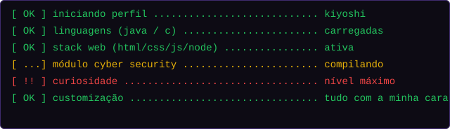
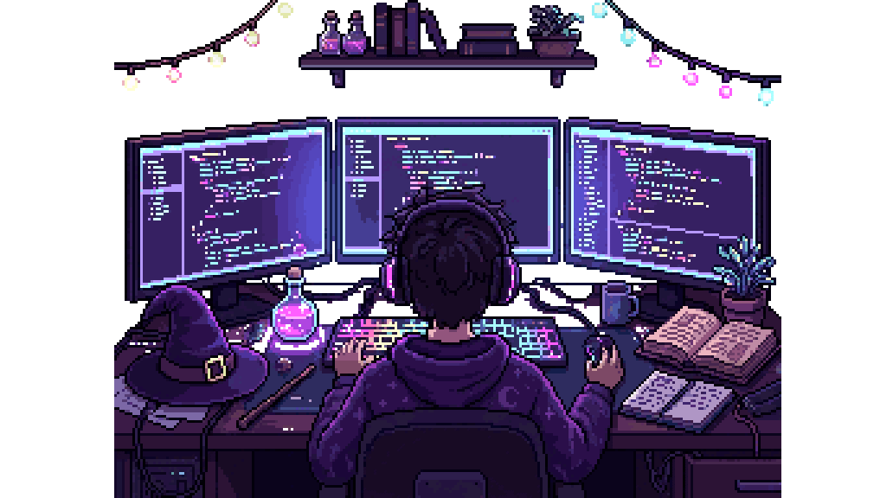

<div align="center">



<a href="https://git.io/typing-svg">
  
</a>

<br/><br/>


</div>




---

## `> whoami`

```bash

nick       : Kiyoshi
curso      : Análise e Desenvolvimento de Sistemas (ADS) — 4 meses de estrada
linguagens : Java | JavaScript | HTML | CSS
foco_atual : construir projetos reais e fixar a base
proxima_fase: CyberSecurity 
hobbies    : customizar coisas, arte, design, hardware
idioma     : pt-BR
```

---



<div align="center">


</div>

---

## 🚀 Projetos

<table>
<tr>
<td width="50%" valign="top">

### 🦷 Sistema de gestão para clínica
Web app que trocou uma planilha manual por um sistema completo.

- Fila de espera, histórico e arquivo
- Impressão de guias de convênio em HTML/CSS/JS puro
- Dashboard com gráficos (Chart.js)
- Migração em andamento: **Supabase + Netlify** com **login (Auth)**

`Node.js` `Express` `Supabase` `Netlify`

</td>
<td width="50%" valign="top">

### 🖱️ Tema custom para mouse gamer
Skin pixel art em cima de um driver open-source (Electron + Vue). No caminho, aprendi como funciona **USB HID**.

`Electron` `Vue` `CSS` `USB HID`

</td>
</tr>
<tr>
<td width="50%" valign="top">

### 🎨 Animações e identidade visual
Logo animado em HTML/CSS/SVG, exportado em PNG transparente e GIF.

`SVG` `CSS Animations` `Design`

</td>
<td width="50%" valign="top">

### 🧮 Calculadora Tkinter
Meu laboratório de Python: ler, entender e modificar código de verdade.

`Python` `Tkinter`

</td>
</tr>
</table>

---

## 🛡️ Missões — rota para Cyber Security

```text
[✔] Lógica e Python básico ............ em andamento
[✔] Web (HTML, CSS, JS, Node) ......... praticando nos projetos
[~] Banco de dados e autenticação ..... Supabase Auth / login
[ ] Redes (TCP/IP, DNS, HTTP) ......... próximo
[ ] Linux e terminal .................. próximo
[ ] Segurança web (OWASP Top 10) ...... próximo
[ ] Laboratórios (TryHackMe / HackTheBox) ... meta
[ ] Certificação inicial .............. meta
```

> 💜 Ainda estou no começo, e é por isso que tudo aqui é público: dá pra acompanhar a evolução commit a commit.

---

## 🎨 Customização & arte

Eu gosto de deixar tudo com a minha cara: interfaces, periféricos, setups, logos, temas escuros e pixel art. Código e design andam juntos pra mim.

<div align="center">

<!-- Troque pelo link de um GIF seu (setup, pixel art, terminal...).
     Dica: giphy.com → "Copy link" → "GIF Link" -->


</div>

---

## 📊 Estatísticas

<div align="center">


<br/>


</div>

---

## 🐍 Contribuições

<!-- Precisa de uma GitHub Action: veja github.com/Platane/snk. Se não quiser, apague esta seção. -->
<div align="center">
  
</div>

---

<div align="center">

### 📡 Contato

[](https://github.com/SEU-USUARIO)
<!-- [](https://instagram.com/seu.usuario) -->
<!-- [](mailto:seu@email.com) -->

<sub>`root@kiyoshi:~# sudo apt install conhecimento` 💜 — [ conexão encerrada ]</sub>


</div>
